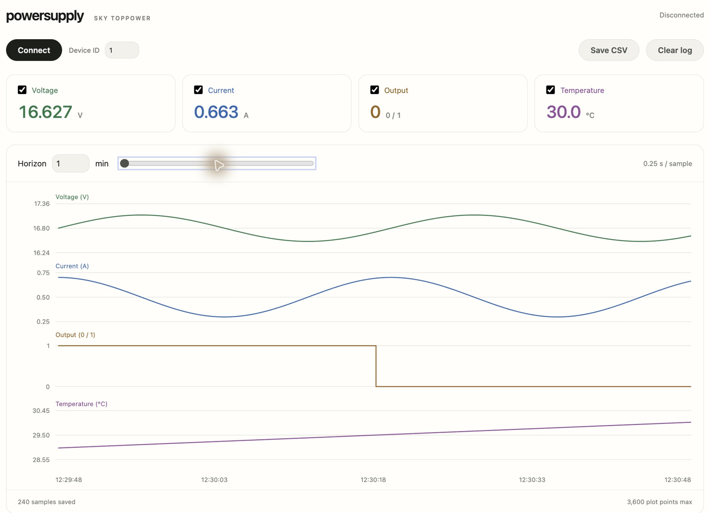

# powersupply

[Open in your browser](https://qwertpas.github.io/powersupply/)

SKY TOPPOWER logger: voltage, current, output (0/1), and temperature. Select traces, adjust the rolling horizon from 1–120 minutes, and save all recorded data as CSV.

1. Connect the supply’s USB-C communication port to your computer.
2. Open in your browser using desktop Chrome or Edge. Click **Connect** and select the supply.
3. Keep the tab open while logging. **Save CSV** exports all samples. Click **Clear log** twice within five seconds to clear, including while logging.

Up to 3,600 plot points; 0.25–2 seconds per sample. Full logs remain in this browser until cleared. All four measurements are recorded regardless of plot selection.
